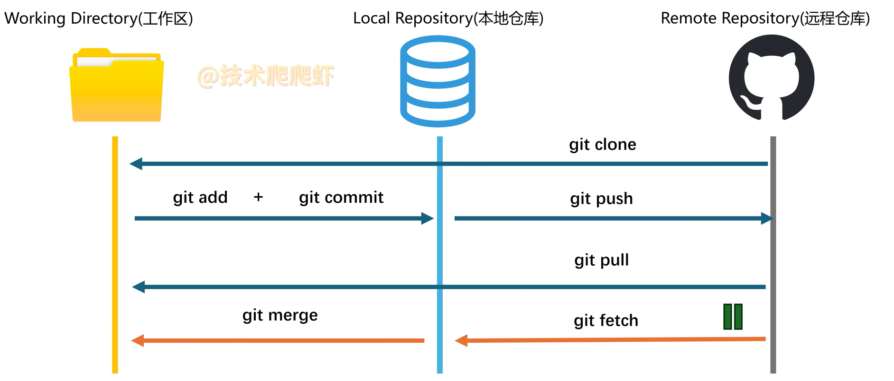

# Git 笔记

## 一、Git 是什么

Git（版本控制）：通俗理解，就是一个保存代码、程序、软件历代版本的软件。

## 二、仓库（Repository）

### 2.1 本地仓库

local repository：本地仓库。

### 2.2 远端仓库

remote repository：远端仓库。

### 2.3 GitHub

GitHub：一个提供 remote repository 的网页。

## 三、把项目上传到 GitHub

先在 GitHub 上创建仓库，然后记住要上传的项目所在文件夹，在 agent 里选择该文件夹，发送：

> 把这个文件夹初始化成 git 项目，并且推送到 GitHub 上面

### 3.1 初始化仓库

`git init`（init：初始化）：在 VSCode 中「文件 → 打开文件夹 → Source Control」初始化仓库。

### 3.2 .gitignore

`.gitignore`：声明哪些文件不受到 Git 管理，在里面输入文件名即可。

优化上传时的提示词：

> 把这个文件夹初始化成 git 项目，注意把不需要的内容排除掉，并且推送到 GitHub 上面

## 四、提交与版本历史（Commit）

每次提交都会形成一次 commit，commit 链就是项目的历史版本。

### 4.1 查看某个历史版本

- **法一**：将鼠标移到要查看的版本，右击鼠标，点击 checkout（detached）〔签出（已分离）〕。
- **法二**：在历史版本上直接创建分支。

### 4.2 Detached

Detached：分离头指针，表示不处于任何一个分支中。

## 五、版本回退与撤销

### 5.1 将仓库回退到某个历史版本

鼠标移到历史版本，右击鼠标，点击 Copy Commit Hash（复制提交哈希），发给 agent：

> 你把仓库还原到 {commit id}，这次提交的状态，后面的所有改动都不要了。

### 5.2 撤掉某次错误提交而不改动其他提交

发给 agent：

> 你把这一次提交撤销掉：{commit id}，保持其他不变。

### 5.3 比较两个版本之间的修改

发给 agent：

> 比较一下 {commit id1} 和 {commit id2} 提交修改了什么内容

## 六、Worktree（工作树）

Worktree：创建主文件分支，对分支的修改不会影响主文件，可以在分支上进行开发测试，最后可以合并到主文件中。

## 七、Git 分区（Git Areas）

- **Working Directory（工作区）**：实际编辑的文件所在目录。
- **Local Repository（本地仓库）**：`git commit` 后版本存放的位置。
- **Remote Repository（远端仓库）**：如 GitHub 上的仓库。

常用命令流向：

| 命令 | 作用 |
| --- | --- |
| `git clone` | 远端仓库 → 工作区 |
| `git add` + `git commit` | 工作区 → 本地仓库 |
| `git push` | 本地仓库 → 远端仓库 |
| `git fetch` | 远端仓库 → 本地仓库（只拉取，不合并） |
| `git pull` | 远端仓库 → 工作区（拉取并合并） |
| `git merge` | 将拉取到的内容合并进当前工作区 |

## 八、与远端仓库协作

### 8.1 克隆远端仓库

复制 GitHub 仓库地址，打开 VSCode「文件 → Source Control → 克隆仓库」。

### 8.2 推送到远端仓库

在 VSCode 里打开文件夹「Source Control → 提交代码 → 发布 branch → 选择账户」。

## 九、GitHub 快捷键

| 快捷键 | 功能 |
| --- | --- |
| `/` | 搜索栏 |
| `T` | 文件搜索栏 |
| `L` | 快速查看代码行 |
| `?` | 查看快捷键 |
| `.` | 网页版 VSCode |
